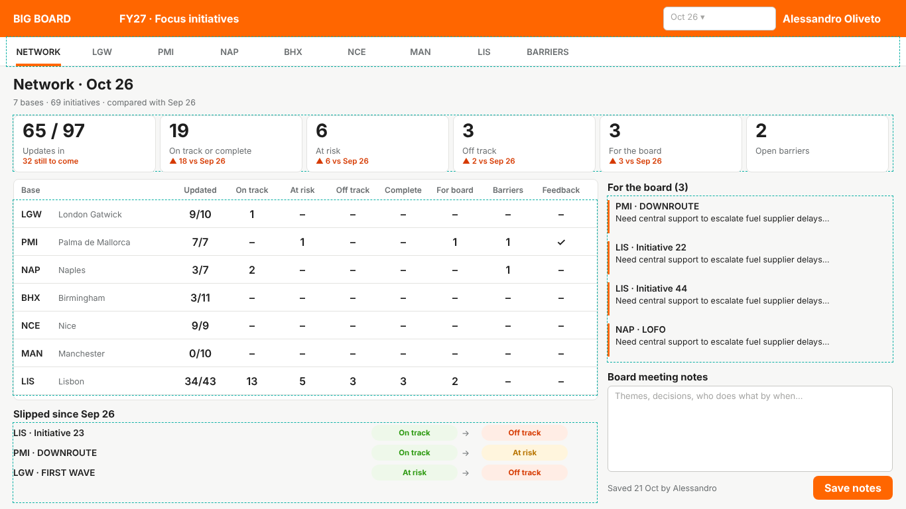
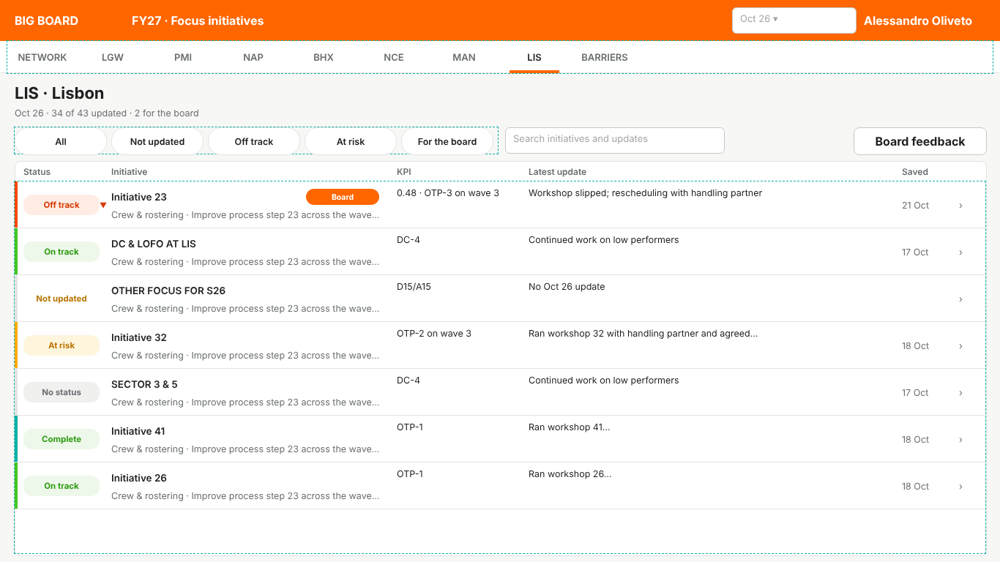
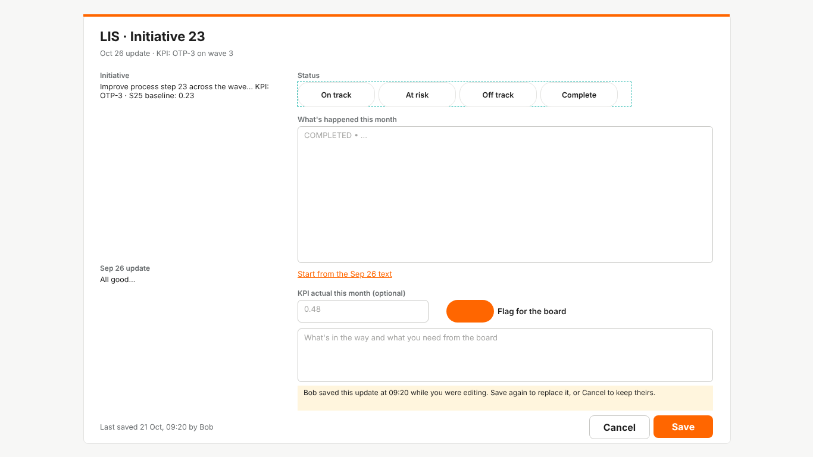
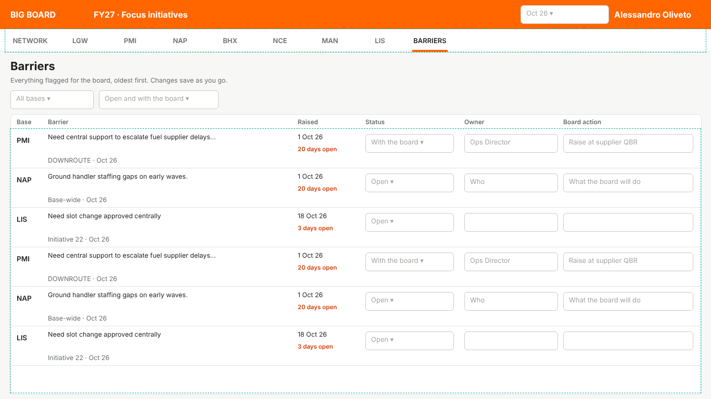
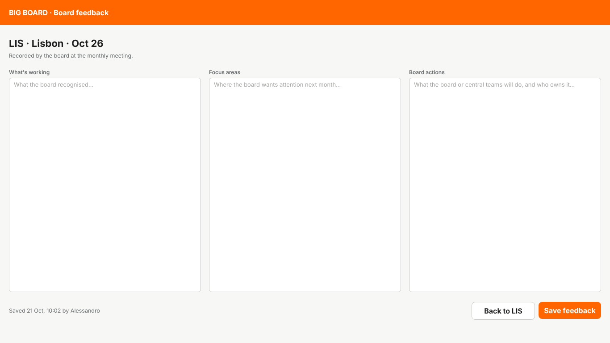

# BIG BOARD in Power Apps: build sheet

A canvas app on three SharePoint lists, built control by control. Every position is for a **1366 × 768** tablet screen. X and Y are from the top-left of the screen, or, for controls inside a gallery, from the top-left of the gallery's first row.

The pictures next to each screen are drawn from the same numbers as the tables, with sample data.

## 1. The three lists (SharePoint Online, in the browser)

### 1a. Create a list

1. Open your SharePoint site.
2. Click **+ New → List → Blank list**.
3. Name it `Initiatives`. Untick *Show in site navigation* if you don't want it in the menu. Click **Create**.
4. Repeat for `Updates` and `Board Feedback`.

### 1b. Add a column

In the list, click **+ Add column** (to the right of the column headings), pick the type, then type the **Name** exactly as in the tables below.

| Type in the tables | What to pick in "+ Add column" | Extra settings in the side panel |
|---|---|---|
| Single line of text | **Single line of text** | |
| Multiple lines, plain text | **Multiple lines of text** | **More options →** switch **Use enhanced rich text** *off* |
| Number | **Number** | |
| Yes/No | **Yes/No** | Default value: as listed |
| Choice | **Choice** | Type each choice on its own line. **Default value: None** |
| Date only | **Date and time** | **More options →** switch **Include time** *off* |

Click **Save** after each column.

### 1c. Required and unique

For "Required" or "enforce unique values":

1. Click the column heading → **Column settings → Edit**.
2. Open **More options**.
3. Switch on **Require that this column contains information** and/or **Enforce unique values**. Unique values also creates the index for you.

For the built-in **Title** column:

1. Click the gear icon **⚙** (top right) → **List settings**.
2. Under *Columns*, click **Title**.
3. Set **Enforce unique values: Yes**. Click **OK**.

### 1d. Indexes

Do this for every column marked "Indexed" below:

1. **⚙ → List settings**.
2. Under *Columns*, click **Indexed columns → Create a new index**.
3. Pick the column. Click **Create**.

### 1e. Version history

1. **⚙ → List settings → Versioning settings**.
2. Check **Create a version each time you edit an item** is **Yes**. It's on by default.

### 1f. Board-only editing on Board Feedback

1. In **Board Feedback**: **⚙ → List settings → Permissions for this list → Stop Inheriting Permissions**.
2. Give the board group **Edit**. Give everyone else **Read**.

In the tables below, the third column lists the options to switch on for that column:

- **Required**: section 1c.
- **Enforce unique values**: section 1c.
- **Indexed**: section 1d.
- **Default Yes/No**: the *Default value* box when you add the column.

Anything else in that column is an example of what goes in it. **You don't enter any of these during setup.** "Filled in by the app" means the app writes it when someone saves. The only value you type yourself is an initiative's **Key**, when you add initiatives to the list. Blank means nothing to switch on.

### Initiatives

| Column | Type | Switch on (see 1c–1d) / example value |
|---|---|---|
| Title | (already there) | Focus area, e.g. FIRST WAVE |
| Key | Single line of text | Required + enforce unique values. **You type this** when adding an initiative: base code in lower case, dash, two digits, e.g. `lgw-03`. Never reuse one |
| Base | Single line of text | Indexed. The three-letter code in capitals: LGW, PMI, … The app's list of bases comes from this column |
| Group | Single line of text | e.g. Focus based on Deep Dive |
| Detail | Multiple lines, plain text | |
| KPI | Multiple lines, plain text | |
| Baseline | Multiple lines, plain text | S25 actuals |
| SortOrder | Number | (not "Order", which SharePoint reserves) |
| Active | Yes/No | Default **Yes** |

Add one row per base with Title **Base-wide**, for asks that don't belong to a specific initiative. Key them `<base>-00`, e.g. `lgw-00`.

### Updates (one row per initiative per month)

| Column | Type | Switch on (see 1c–1d) / example value |
|---|---|---|
| Title | (already there) | Enforce unique values. **Filled in by the app**, e.g. `lgw-03_2026-10` |
| InitiativeKey | Single line of text | Indexed |
| Base | Single line of text | Indexed |
| Month | Single line of text | Indexed. **Filled in by the app**, e.g. `2026-10` |
| Status | Choice | On track / At risk / Off track / Complete |
| UpdateText | Multiple lines, plain text | |
| KPIActual | Single line of text | |
| ForBoard | Yes/No | Default **No**. Indexed |
| BoardAsk | Multiple lines, plain text | |
| BarrierStatus | Choice | Open / With the board / Resolved |
| BarrierOwner | Single line of text | |
| BoardAction | Single line of text | |
| RaisedOn | Date only | |

### Board Feedback (one row per base per month, plus `NET_<month>` for network notes)

| Column | Type | Switch on (see 1c–1d) / example value |
|---|---|---|
| Title | (already there) | Enforce unique values. **Filled in by the app**, e.g. `LGW_2026-10`, or `NET_2026-10` for network notes |
| Base | Single line of text | |
| Month | Single line of text | Indexed. **Filled in by the app** |
| Working | Multiple lines, plain text | |
| Focus | Multiple lines, plain text | |
| Actions | Multiple lines, plain text | |
| Notes | Multiple lines, plain text | |

**Name columns without spaces when you create them.** SharePoint fixes a column's internal name at creation, and that's what the formulas use. You can change the display name afterwards, but the formulas will still need the original.

## 2. Create the app (Power Apps, in the browser)

### 2a. New app

1. Go to **make.powerapps.com**. Check the environment (top right) is your organisation's default, unless IT gave you another.
2. Left menu: **+ Create → Blank app → Blank canvas app → Create**.
3. App name: `BIG BOARD`. Format: **Tablet**. Click **Create**.

### 2b. App settings

1. Top bar: **Settings** (gear).
2. **Display:** App layout **Fixed** · Orientation **Landscape** · Size **16:9 Default** (that's 1366 × 768) · **Lock aspect ratio** On · **Lock orientation** On.
3. **Updates → New** (or **Preview**): turn on **User-defined functions**, if it's listed. Close.

### 2c. Connect the lists

1. Left rail: **Data** (cylinder icon) **→ + Add data**.
2. Search **SharePoint**, then choose **Connect directly (cloud services)**.
3. Pick your site from *Recent sites*, or paste its URL. Tick **Initiatives**, **Updates**, **Board Feedback**. Click **Connect**.

### 2d. Screens

1. Left rail: **Tree view**. Click **+ New screen → Blank**, four times.
2. Rename the five screens by double-clicking each name: `scrNetwork`, `scrBase`, `scrEdit`, `scrBarriers`, `scrFeedback`.
3. Set each screen's **Fill** property to `cBg`.

### 2e. Adding a control and setting its position

1. Left rail: **+ Insert**. Search **Label**, **Button**, **Text input**, **Drop down**, **Toggle** or **Rectangle**, and pick the one under the **Classic** heading. For galleries, choose **Blank vertical gallery** or **Blank horizontal gallery**.
2. Rename it in **Tree view** by double-clicking.
3. Set **X, Y, Width, Height** in the right-hand **Properties** pane, under *Position* and *Size*.
4. For every other property, pick it from the **property drop-down** at the left of the formula bar and paste the formula into the formula bar.

**Putting controls inside a gallery:** select the gallery, click the **pencil icon** at its top-left (edit the template), then insert. Inserted controls go into the first row, and their X/Y are measured from that row's top-left.

**App-level formulas:** in Tree view, click **App** at the top. Choose **Formulas** or **OnStart** in the property drop-down.

### 2f. Save, publish, put it on SharePoint

1. **Ctrl+S**, then **Publish** (top right) **→ Publish this version**.
2. **Share it:** **Share** (top right). Add the people or group. The lists' SharePoint permissions still decide who can edit.
3. **Find its link:** go to **make.powerapps.com → Apps → … next to BIG BOARD → Details** and copy the **Web link**.
4. **Add it to a SharePoint page:**
   1. Open the page and click **Edit**.
   2. Click **+**, choose **Power Apps**, paste the link, and set the height to about **800**.
   3. Click **Republish**.
5. **Optional, Teams:** **Apps → … → Add to Teams**.

### 2g. Styling defaults

Set these once on a control, then copy that control as you build:

- **Labels:** Font `Font.'Segoe UI'`, Size 10.5, Color `cInk`, PaddingLeft 0.
- **Primary buttons:** Fill `cOrange`, Color White, HoverFill `ColorValue("#FF4600")`, BorderThickness 0, all four radius properties 8.
- **Secondary buttons:** Fill White, Color `cInk`, BorderColor `cLine`, BorderThickness 1, HoverFill `ColorValue("#F4F4F3")`, radius 8.
- **Text inputs:** BorderColor `cLine`, FocusedBorderColor `cOrange`, all four radius properties 6, Size 10.5.
- **Galleries:** TemplatePadding 0, Fill Transparent.

## 3. App properties

**App → Formulas** (named formulas: constants and helper functions)

```
cOrange = ColorValue("#FF6600");
cInk    = ColorValue("#1E1E1E");
cMuted  = ColorValue("#696D6F");
cFaint  = ColorValue("#A4A4A2");
cBg     = ColorValue("#F7F7F6");
cLine   = ColorValue("#E3E3E1");

// Every base, in the order they appear in the picker and tables. A base shows in the app once it
// is listed here AND has at least one active initiative.
tBaseInfo = Table(
    {Code: "BFS", Name: "Belfast",            Region: "UK",          R: 1},
    {Code: "BHX", Name: "Birmingham",         Region: "UK",          R: 1},
    {Code: "BRS", Name: "Bristol",            Region: "UK",          R: 1},
    {Code: "EDI", Name: "Edinburgh",          Region: "UK",          R: 1},
    {Code: "GLA", Name: "Glasgow",            Region: "UK",          R: 1},
    {Code: "LGW", Name: "London Gatwick",     Region: "UK",          R: 1},
    {Code: "LPL", Name: "Liverpool",          Region: "UK",          R: 1},
    {Code: "LTN", Name: "London Luton",       Region: "UK",          R: 1},
    {Code: "MAN", Name: "Manchester",         Region: "UK",          R: 1},
    {Code: "NCL", Name: "Newcastle",          Region: "UK",          R: 1},
    {Code: "SEN", Name: "London Southend",    Region: "UK",          R: 1},
    {Code: "AGP", Name: "Málaga",             Region: "Europe",      R: 2},
    {Code: "ALC", Name: "Alicante",           Region: "Europe",      R: 2},
    {Code: "AMS", Name: "Amsterdam",          Region: "Europe",      R: 2},
    {Code: "BCN", Name: "Barcelona",          Region: "Europe",      R: 2},
    {Code: "BER", Name: "Berlin",             Region: "Europe",      R: 2},
    {Code: "BOD", Name: "Bordeaux",           Region: "Europe",      R: 2},
    {Code: "CDG", Name: "Paris CDG",          Region: "Europe",      R: 2},
    {Code: "FAO", Name: "Faro",               Region: "Europe",      R: 2},
    {Code: "FCO", Name: "Rome Fiumicino",     Region: "Europe",      R: 2},
    {Code: "LIN", Name: "Milan Linate",       Region: "Europe",      R: 2},
    {Code: "LIS", Name: "Lisbon",             Region: "Europe",      R: 2},
    {Code: "LYS", Name: "Lyon",               Region: "Europe",      R: 2},
    {Code: "MXP", Name: "Milan Malpensa",     Region: "Europe",      R: 2},
    {Code: "NAP", Name: "Naples",             Region: "Europe",      R: 2},
    {Code: "NCE", Name: "Nice",               Region: "Europe",      R: 2},
    {Code: "NTE", Name: "Nantes",             Region: "Europe",      R: 2},
    {Code: "OPO", Name: "Porto",              Region: "Europe",      R: 2},
    {Code: "ORY", Name: "Paris Orly",         Region: "Europe",      R: 2},
    {Code: "PMI", Name: "Palma de Mallorca",  Region: "Europe",      R: 2},
    {Code: "BSL", Name: "Basel-Mulhouse",     Region: "Switzerland", R: 3},
    {Code: "GVA", Name: "Geneva",             Region: "Switzerland", R: 3},
    {Code: "RAK", Name: "Marrakech",          Region: "Morocco",     R: 4}
);

// Sep 26 (FY26 close-out) to Sep 27. Change the start date and count for FY28.
tMonths = ForAll(Sequence(13),
    With({d: DateAdd(Date(2026, 9, 1), Value - 1, TimeUnit.Months)},
        {Key: Text(d, "yyyy-mm"), Label: Text(d, "mmm yy")}));

MonthLabel(k: Text): Text = LookUp(tMonths, Key = k).Label;

// On track and Complete count as the same level, so finishing something is never a "slip".
StatusRank(s: Text): Number = Switch(s, "Off track", 2, "At risk", 1, 0);

StatusFg(s: Text): Color = Switch(s,
    "On track", ColorValue("#2E9A12"), "At risk", ColorValue("#B87400"),
    "Off track", ColorValue("#D63A00"), "Complete", ColorValue("#07857C"), cMuted);
StatusBg(s: Text): Color = Switch(s,
    "On track", ColorValue("#EEF8EA"), "At risk", ColorValue("#FFF5DD"),
    "Off track", ColorValue("#FFEDE5"), "Complete", ColorValue("#E6F6F4"), ColorValue("#F0F0EF"));
StatusStripe(s: Text): Color = Switch(s,
    "On track", ColorValue("#42C620"), "At risk", ColorValue("#FFAA00"),
    "Off track", ColorValue("#FF4600"), "Complete", ColorValue("#0AB0A5"), cLine);
```

**App → OnStart**

```
Set(varMonth, If(IsBlank(LookUp(tMonths, Key = Text(Today(), "yyyy-mm"))), "2026-10", Text(Today(), "yyyy-mm")));
Set(varView, "NETWORK");
Set(varFilter, "All");
ClearCollect(colInits, Filter(Initiatives, Active = true));
Set(varRegion, "All");
// Bases from tBaseInfo that have at least one active initiative, in tBaseInfo's order.
ClearCollect(colBases, Filter(tBaseInfo, Code in colInits.Base));
Set(varPrev, Text(DateAdd(Date(Value(Left(varMonth, 4)), Value(Right(varMonth, 2)), 1), -1, TimeUnit.Months), "yyyy-mm"));
Concurrent(
    ClearCollect(colUpd,  Filter(Updates, Month = varMonth)),
    ClearCollect(colPrev, Filter(Updates, Month = varPrev)),
    ClearCollect(colFb,   Filter('Board Feedback', Month = varMonth)),
    ClearCollect(colBar,  Filter(Updates, ForBoard = true))
);
```

**The reload block.** The last part of OnStart, from `Set(varPrev, …` to the closing `)`, is referred to below as **<RELOAD BLOCK>**. Paste it wherever that appears: the month drop-downs and the Save button. It loads the selected month, the month before for comparisons, board feedback, and every flagged item for the barriers list. Each filter runs on SharePoint's side, so it keeps working as the lists grow.

**App → StartScreen:** `scrNetwork`

## 4. scrNetwork: Network



**Screen OnVisible**

```
Set(varView, "NETWORK")
```

| Control | Type | X | Y | W | H | Inside |
|---|---|---|---|---|---|---|
| `recHeader` | Rectangle | 0 | 0 | 1366 | 56 | |
| `lblBrand` | Label | 20 | 0 | 160 | 56 | |
| `lblFY` | Label | 180 | 0 | 260 | 56 | |
| `ddMonth` | Drop down | 1000 | 10 | 170 | 36 | |
| `lblUser` | Label | 1180 | 0 | 166 | 56 | |
| `recNav` | Rectangle | 0 | 56 | 1366 | 44 | |
| `recNavLine` | Rectangle | 0 | 99 | 1366 | 1 | |
| `galNav` | Gallery (horizontal, blank) | 10 | 56 | 220 | 44 | |
| `btnTab` | Button | 0 | 0 | 110 | 44 | `galNav` |
| `recTabOn` | Rectangle | 14 | 40 | 82 | 4 | `galNav` |
| `cmbBase` | Combo box | 250 | 60 | 280 | 36 | |
| `lblNetTitle` | Label | 20 | 110 | 700 | 34 | |
| `lblNetSub` | Label | 20 | 142 | 900 | 24 | |
| `galKpi` | Gallery (horizontal, blank) | 20 | 174 | 1326 | 84 | |
| `recTile` | Rectangle | 0 | 0 | 213 | 84 | `galKpi` |
| `lblKpiV` | Label | 14 | 6 | 190 | 38 | `galKpi` |
| `lblKpiL` | Label | 14 | 44 | 190 | 18 | `galKpi` |
| `lblKpiD` | Label | 14 | 62 | 190 | 18 | `galKpi` |
| `recBasesCard` | Rectangle | 20 | 270 | 880 | 332 | |
| `galRegion` | Gallery (horizontal, blank) | 32 | 278 | 560 | 30 | |
| `btnRegion` | Button | 0 | 0 | 104 | 30 | `galRegion` |
| `lblNBase` | Label | 32 | 310 | 230 | 28 | |
| `lblNUpdated` | Label | 262 | 310 | 80 | 28 | |
| `lblNOnTrack` | Label | 342 | 310 | 76 | 28 | |
| `lblNAtRisk` | Label | 418 | 310 | 76 | 28 | |
| `lblNOffTrack` | Label | 494 | 310 | 76 | 28 | |
| `lblNComplete` | Label | 570 | 310 | 76 | 28 | |
| `lblNForBoard` | Label | 646 | 310 | 80 | 28 | |
| `lblNBarriers` | Label | 726 | 310 | 80 | 28 | |
| `lblNFeedback` | Label | 806 | 310 | 80 | 28 | |
| `galBases` | Gallery (vertical, blank) | 20 | 338 | 880 | 258 | |
| `lblBCode` | Label | 12 | 0 | 56 | 42 | `galBases` |
| `lblBName` | Label | 68 | 0 | 170 | 42 | `galBases` |
| `lblBUpdated` | Label | 242 | 0 | 80 | 42 | `galBases` |
| `lblBOn` | Label | 322 | 0 | 76 | 42 | `galBases` |
| `lblBRisk` | Label | 398 | 0 | 76 | 42 | `galBases` |
| `lblBOff` | Label | 474 | 0 | 76 | 42 | `galBases` |
| `lblBDone` | Label | 550 | 0 | 76 | 42 | `galBases` |
| `lblBBoard` | Label | 626 | 0 | 80 | 42 | `galBases` |
| `lblBBarriers` | Label | 706 | 0 | 80 | 42 | `galBases` |
| `lblBFeedback` | Label | 786 | 0 | 80 | 42 | `galBases` |
| `recBSep` | Rectangle | 0 | 41 | 880 | 1 | `galBases` |
| `lblSlipHdr` | Label | 20 | 612 | 880 | 24 | |
| `galSlipped` | Gallery (vertical, blank) | 20 | 638 | 880 | 120 | |
| `lblSlipWho` | Label | 0 | 0 | 520 | 30 | `galSlipped` |
| `lblSlipFrom` | Label | 540 | 3 | 130 | 24 | `galSlipped` |
| `lblSlipArrow` | Label | 676 | 3 | 24 | 24 | `galSlipped` |
| `lblSlipTo` | Label | 706 | 3 | 130 | 24 | `galSlipped` |
| `lblAsksHdr` | Label | 916 | 270 | 430 | 24 | |
| `galAsks` | Gallery (vertical, blank) | 916 | 296 | 430 | 250 | |
| `recAskBar` | Rectangle | 0 | 6 | 3 | 50 | `galAsks` |
| `lblAskWho` | Label | 12 | 4 | 410 | 22 | `galAsks` |
| `lblAskText` | Label | 12 | 26 | 410 | 34 | `galAsks` |
| `lblNotesHdr` | Label | 916 | 556 | 430 | 24 | |
| `txtNotes` | Text input | 916 | 582 | 430 | 130 | |
| `lblNotesSaved` | Label | 916 | 718 | 300 | 36 | |
| `btnSaveNotes` | Button | 1226 | 718 | 120 | 36 | |

### Properties

**`recHeader`**

```
Fill: cOrange
```

**`lblBrand`**

```
Text: "BIG BOARD"
Color: Color.White
Size: 20
FontWeight: FontWeight.Bold
```

**`lblFY`**

```
Text: "FY27 · Focus initiatives"
Color: Color.White
Size: 11
```

**`ddMonth`**

```
Items: tMonths
Value (right-hand pane): Label
Default: MonthLabel(varMonth)
OnChange:
    Set(varMonth, Self.Selected.Key);
    Set(varPrev, Text(DateAdd(Date(Value(Left(varMonth, 4)), Value(Right(varMonth, 2)), 1), -1, TimeUnit.Months), "yyyy-mm"));
    Concurrent(
        ClearCollect(colUpd,  Filter(Updates, Month = varMonth)),
        ClearCollect(colPrev, Filter(Updates, Month = varPrev)),
        ClearCollect(colFb,   Filter('Board Feedback', Month = varMonth)),
        ClearCollect(colBar,  Filter(Updates, ForBoard = true))
    )
```

**`lblUser`**

```
Text: User().FullName
Color: Color.White
Size: 11
Align: Align.Right
```

**`recNav`**

```
Fill: Color.White
```

**`recNavLine`**

```
Fill: cLine
```

**`galNav`**

```
Items: ["NETWORK", "BARRIERS"]
TemplateSize: 110
TemplatePadding: 0
ShowScrollbar: false
```

**`btnTab`** (in `galNav`)

```
Text: ThisItem.Value
Fill: Color.Transparent
HoverFill: RGBA(0,0,0,0.04)
PressedFill: RGBA(0,0,0,0.08)
Color: If(varView = ThisItem.Value, cInk, cMuted)
HoverColor: cInk
BorderThickness: 0
RadiusTopLeft … RadiusBottomRight: 0
Size: 11
FontWeight: FontWeight.Semibold
OnSelect:
    Set(varView, ThisItem.Value);
    Navigate(If(ThisItem.Value = "NETWORK", scrNetwork, scrBarriers), ScreenTransition.None)
```

**`recTabOn`** (in `galNav`)

```
Fill: cOrange
Visible: varView = ThisItem.Value
```

**`cmbBase`**

```
Items: colBases
DisplayFields: ["Code", "Name"]
SearchFields: ["Code", "Name"]
IsSearchable: true
SelectMultiple: false
InputTextPlaceholder: "Go to a base…"
DefaultSelectedItems: Filter(colBases, Code = varView)
OnChange:
    If(!IsBlank(Self.Selected),
        Set(varView, Self.Selected.Code);
        Set(varFilter, "All");
        Navigate(scrBase, ScreenTransition.None))
BorderColor: If(LookUp(colBases, Code = varView, true), cOrange, cLine)
```

**`lblNetTitle`**

```
Text: "Network · " & MonthLabel(varMonth)
Size: 18
FontWeight: FontWeight.Bold
Color: cInk
```

**`lblNetSub`**

```
Text: CountRows(colBases) & " bases · " & CountRows(colInits) & " initiatives · compared with " & MonthLabel(varPrev)
Size: 10.5
Color: cMuted
```

**`galKpi`**

```
Items:
    Table(
        {L: "Updates in",           N: CountRows(colUpd), Of: CountRows(colInits), UpBad: false},
        {L: "On track or complete", N: CountIf(colUpd,  Status.Value = "On track" || Status.Value = "Complete"),
                                    P: CountIf(colPrev, Status.Value = "On track" || Status.Value = "Complete"), UpBad: false},
        {L: "At risk",              N: CountIf(colUpd, Status.Value = "At risk"),   P: CountIf(colPrev, Status.Value = "At risk"),   UpBad: true},
        {L: "Off track",            N: CountIf(colUpd, Status.Value = "Off track"), P: CountIf(colPrev, Status.Value = "Off track"), UpBad: true},
        {L: "For the board",        N: CountIf(colUpd, ForBoard),                   P: CountIf(colPrev, ForBoard),                   UpBad: true},
        {L: "Open barriers",        N: CountIf(colBar, BarrierStatus.Value <> "Resolved"), UpBad: true}
    )
TemplateSize: 221
TemplatePadding: 0
ShowScrollbar: false
```

**`recTile`** (in `galKpi`)

```
Fill: Color.White
BorderColor: cLine
BorderThickness: 1
```

**`lblKpiV`** (in `galKpi`)

```
Text: ThisItem.N & If(!IsBlank(ThisItem.Of), " / " & ThisItem.Of, "")
Size: 22
FontWeight: FontWeight.Bold
Color: If(ThisItem.N = 0, cInk, Switch(ThisItem.L, "At risk", StatusFg("At risk"), "Off track", StatusFg("Off track"), "For the board", cOrange, "Open barriers", StatusFg("Off track"), cInk))
```

**`lblKpiL`** (in `galKpi`)

```
Text: ThisItem.L
Size: 10
FontWeight: FontWeight.Semibold
Color: cMuted
```

**`lblKpiD`** (in `galKpi`)

```
Text:
    If(IsBlank(ThisItem.P),
        If(IsBlank(ThisItem.Of), "", If(ThisItem.Of = ThisItem.N, "All in", (ThisItem.Of - ThisItem.N) & " still to come")),
        If(ThisItem.N = ThisItem.P, "Same as " & MonthLabel(varPrev),
           If(ThisItem.N > ThisItem.P, "▲ ", "▼ ") & Abs(ThisItem.N - ThisItem.P) & " vs " & MonthLabel(varPrev)))
Size: 9.5
FontWeight: FontWeight.Semibold
Color:
    If(IsBlank(ThisItem.P) || ThisItem.N = ThisItem.P, cMuted,
       If((ThisItem.N > ThisItem.P) = ThisItem.UpBad, StatusFg("Off track"), StatusFg("On track")))
```

**`recBasesCard`**

```
Fill: Color.White
BorderColor: cLine
BorderThickness: 1
```

**`galRegion`**

```
Items: ["All", "UK", "Europe", "Switzerland", "Morocco"]
TemplateSize: 112
TemplatePadding: 0
ShowScrollbar: false
```

**`btnRegion`** (in `galRegion`)

```
Text: ThisItem.Value
OnSelect: Set(varRegion, ThisItem.Value)
Fill: If(Coalesce(varRegion, "All") = ThisItem.Value, cInk, Color.White)
Color: If(Coalesce(varRegion, "All") = ThisItem.Value, Color.White, cInk)
BorderColor: cLine
BorderThickness: 1
Size: 9.5
Radius (all four): 15
```

**`lblNBase`**

```
Text: "Base"
Size: 9.5
FontWeight: FontWeight.Semibold
Color: cMuted
```

**`lblNUpdated`**

```
Text: "Updated"
Size: 9.5
FontWeight: FontWeight.Semibold
Color: cMuted
Align: Align.Center
```

**`lblNOnTrack`**

```
Text: "On track"
Size: 9.5
FontWeight: FontWeight.Semibold
Color: cMuted
Align: Align.Center
```

**`lblNAtRisk`**

```
Text: "At risk"
Size: 9.5
FontWeight: FontWeight.Semibold
Color: cMuted
Align: Align.Center
```

**`lblNOffTrack`**

```
Text: "Off track"
Size: 9.5
FontWeight: FontWeight.Semibold
Color: cMuted
Align: Align.Center
```

**`lblNComplete`**

```
Text: "Complete"
Size: 9.5
FontWeight: FontWeight.Semibold
Color: cMuted
Align: Align.Center
```

**`lblNForBoard`**

```
Text: "For board"
Size: 9.5
FontWeight: FontWeight.Semibold
Color: cMuted
Align: Align.Center
```

**`lblNBarriers`**

```
Text: "Barriers"
Size: 9.5
FontWeight: FontWeight.Semibold
Color: cMuted
Align: Align.Center
```

**`lblNFeedback`**

```
Text: "Feedback"
Size: 9.5
FontWeight: FontWeight.Semibold
Color: cMuted
Align: Align.Center
```

**`galBases`**

```
Items: Filter(colBases, Coalesce(varRegion, "All") = "All" || Region = varRegion)
TemplateSize: 42
TemplatePadding: 0
OnSelect:
    Set(varView, ThisItem.Code);
    Set(varFilter, "All");
    Navigate(scrBase, ScreenTransition.None)
```

**`lblBCode`** (in `galBases`)

```
Text: ThisItem.Code
Size: 13
FontWeight: FontWeight.Bold
Color: cInk
```

**`lblBName`** (in `galBases`)

```
Text: ThisItem.Name
Size: 10
Color: cMuted
```

**`lblBUpdated`** (in `galBases`)

```
Text: CountRows(Filter(colUpd, Base = ThisItem.Code)) & "/" & CountRows(Filter(colInits, Base = ThisItem.Code))
Align: Align.Center
Color: If(CountRows(Filter(colUpd, Base = ThisItem.Code)) < CountRows(Filter(colInits, Base = ThisItem.Code)), StatusFg("At risk"), cInk)
FontWeight: FontWeight.Semibold
```

**`lblBOn`** (in `galBases`)

```
Text: With({n: CountIf(colUpd, Base = ThisItem.Code && Status.Value = "On track")}, If(n = 0, "–", Text(n)))
Color: If(Self.Text = "–", cFaint, StatusFg("On track"))
Align: Align.Center
FontWeight: FontWeight.Semibold
```

**`lblBRisk`** (in `galBases`)

```
Text: With({n: CountIf(colUpd, Base = ThisItem.Code && Status.Value = "At risk")}, If(n = 0, "–", Text(n)))
Color: If(Self.Text = "–", cFaint, StatusFg("At risk"))
Align: Align.Center
FontWeight: FontWeight.Semibold
```

**`lblBOff`** (in `galBases`)

```
Text: With({n: CountIf(colUpd, Base = ThisItem.Code && Status.Value = "Off track")}, If(n = 0, "–", Text(n)))
Color: If(Self.Text = "–", cFaint, StatusFg("Off track"))
Align: Align.Center
FontWeight: FontWeight.Semibold
```

**`lblBDone`** (in `galBases`)

```
Text: With({n: CountIf(colUpd, Base = ThisItem.Code && Status.Value = "Complete")}, If(n = 0, "–", Text(n)))
Color: If(Self.Text = "–", cFaint, StatusFg("Complete"))
Align: Align.Center
FontWeight: FontWeight.Semibold
```

**`lblBBoard`** (in `galBases`)

```
Text: With({n: CountIf(colUpd, Base = ThisItem.Code && ForBoard)}, If(n = 0, "–", Text(n)))
Color: If(Self.Text = "–", cFaint, cOrange)
Align: Align.Center
FontWeight: FontWeight.Bold
```

**`lblBBarriers`** (in `galBases`)

```
Text: With({n: CountIf(colBar, Base = ThisItem.Code && BarrierStatus.Value <> "Resolved")}, If(n = 0, "–", Text(n)))
Color: If(Self.Text = "–", cFaint, StatusFg("Off track"))
Align: Align.Center
```

**`lblBFeedback`** (in `galBases`)

```
Text: If(IsBlank(LookUp(colFb, Title = ThisItem.Code & "_" & varMonth)), "–", "✓")
Color: If(Self.Text = "–", cFaint, StatusFg("On track"))
Align: Align.Center
```

**`recBSep`** (in `galBases`)

```
Fill: cLine
```

**`lblSlipHdr`**

```
Text: "Slipped since " & MonthLabel(varPrev) & "  (" & CountRows(galSlipped.AllItems) & ")"
Size: 12
FontWeight: FontWeight.Bold
```

**`galSlipped`**

```
Items:
    Filter(
        AddColumns(colUpd,
            PrevStatus, LookUp(colPrev As p, p.InitiativeKey = InitiativeKey).Status.Value,
            InitTitle,  LookUp(colInits As i, i.Key = InitiativeKey).Title),
        !IsBlank(PrevStatus) && StatusRank(Status.Value) > StatusRank(PrevStatus)
    )
TemplateSize: 30
TemplatePadding: 0
OnSelect:
    Set(varView, ThisItem.Base);
    Set(varFilter, "All");
    Navigate(scrBase, ScreenTransition.None)
```

**`lblSlipWho`** (in `galSlipped`)

```
Text: ThisItem.Base & " · " & ThisItem.InitTitle
FontWeight: FontWeight.Semibold
```

**`lblSlipFrom`** (in `galSlipped`)

```
Text: ThisItem.PrevStatus
Fill: StatusBg(ThisItem.PrevStatus)
Color: StatusFg(ThisItem.PrevStatus)
Align: Align.Center
Size: 9.5
FontWeight: FontWeight.Bold
Radius (all four): 12
```

**`lblSlipArrow`** (in `galSlipped`)

```
Text: "→"
Color: cFaint
Align: Align.Center
```

**`lblSlipTo`** (in `galSlipped`)

```
Text: ThisItem.Status.Value
Fill: StatusBg(ThisItem.Status.Value)
Color: StatusFg(ThisItem.Status.Value)
Align: Align.Center
Size: 9.5
FontWeight: FontWeight.Bold
Radius (all four): 12
```

**`lblAsksHdr`**

```
Text: "For the board  (" & CountRows(galAsks.AllItems) & ")"
Size: 12
FontWeight: FontWeight.Bold
```

**`galAsks`**

```
Items: Filter(colUpd, ForBoard)
TemplateSize: 62
TemplatePadding: 0
OnSelect:
    Set(varView, ThisItem.Base);
    Set(varFilter, "For the board");
    Navigate(scrBase, ScreenTransition.None)
```

**`recAskBar`** (in `galAsks`)

```
Fill: cOrange
```

**`lblAskWho`** (in `galAsks`)

```
Text: ThisItem.Base & " · " & LookUp(colInits, Key = ThisItem.InitiativeKey).Title
FontWeight: FontWeight.Semibold
```

**`lblAskText`** (in `galAsks`)

```
Text: ThisItem.BoardAsk
Size: 9.5
Color: cInk
Wrap: true
VerticalAlign: VerticalAlign.Top
```

**`lblNotesHdr`**

```
Text: "Board meeting notes"
Size: 12
FontWeight: FontWeight.Bold
```

**`txtNotes`**

```
Mode: TextMode.MultiLine
Default: LookUp(colFb, Title = "NET_" & varMonth).Notes
HintText: "Themes, decisions, who does what by when…"
```

**`lblNotesSaved`**

```
Text: With({r: LookUp(colFb, Title = "NET_" & varMonth)}, If(IsBlank(r), "", "Saved " & Text(r.Modified, "d mmm") & " by " & r.Editor.DisplayName))
Size: 9.5
Color: cMuted
```

**`btnSaveNotes`**

```
Text: "Save notes"
Fill: cOrange
Color: Color.White
OnSelect:
    With({r: LookUp('Board Feedback', Title = "NET_" & varMonth)},
        Patch('Board Feedback', If(IsBlank(r), Defaults('Board Feedback'), r),
            {Title: "NET_" & varMonth, Base: "NET", Month: varMonth, Notes: txtNotes.Text}));
    ClearCollect(colFb, Filter('Board Feedback', Month = varMonth));
    Notify("Notes saved", NotificationType.Success)
```

## 5. scrBase: Base (one screen for every base)



The header and tab bar (everything named `…_1` / `…_2`) are a copy of the ones on scrNetwork. Select those nine controls on scrNetwork, copy, and paste them here. Power Apps adds the suffix and keeps positions.

| Control | Type | X | Y | W | H | Inside |
|---|---|---|---|---|---|---|
| `recHeader_1` | Rectangle | 0 | 0 | 1366 | 56 | |
| `lblBrand_1` | Label | 20 | 0 | 160 | 56 | |
| `lblFY_1` | Label | 180 | 0 | 260 | 56 | |
| `ddMonth_1` | Drop down | 1000 | 10 | 170 | 36 | |
| `lblUser_1` | Label | 1180 | 0 | 166 | 56 | |
| `recNav_1` | Rectangle | 0 | 56 | 1366 | 44 | |
| `recNavLine_1` | Rectangle | 0 | 99 | 1366 | 1 | |
| `galNav_1` | Gallery (horizontal, blank) | 10 | 56 | 220 | 44 | |
| `btnTab_1` | Button | 0 | 0 | 110 | 44 | `galNav_1` |
| `recTabOn_1` | Rectangle | 14 | 40 | 82 | 4 | `galNav_1` |
| `cmbBase_1` | Combo box | 250 | 60 | 280 | 36 | |
| `lblBaseTitle` | Label | 20 | 110 | 700 | 34 | |
| `lblBaseSub` | Label | 20 | 142 | 900 | 24 | |
| `galFilters` | Gallery (horizontal, blank) | 20 | 174 | 660 | 36 | |
| `btnFilter` | Button | 0 | 0 | 124 | 36 | `galFilters` |
| `txtSearch` | Text input | 690 | 174 | 300 | 36 | |
| `btnFeedback` | Button | 1166 | 174 | 180 | 36 | |
| `recListCard` | Rectangle | 20 | 220 | 1326 | 538 | |
| `lblIStatus` | Label | 32 | 220 | 110 | 28 | |
| `lblIInitiative` | Label | 152 | 220 | 380 | 28 | |
| `lblIKpi` | Label | 542 | 220 | 170 | 28 | |
| `lblILatestUpdate` | Label | 722 | 220 | 500 | 28 | |
| `lblISaved` | Label | 1232 | 220 | 70 | 28 | |
| `galInits` | Gallery (vertical, blank) | 20 | 248 | 1326 | 508 | |
| `recStripe` | Rectangle | 0 | 0 | 4 | 63 | `galInits` |
| `lblChip` | Label | 12 | 18 | 104 | 28 | `galInits` |
| `lblTrend` | Label | 116 | 20 | 16 | 24 | `galInits` |
| `lblTitle` | Label | 132 | 8 | 262 | 26 | `galInits` |
| `lblBoardTag` | Label | 398 | 10 | 100 | 22 | `galInits` |
| `lblSub` | Label | 132 | 34 | 380 | 22 | `galInits` |
| `lblKpi` | Label | 522 | 8 | 170 | 48 | `galInits` |
| `lblUpdate` | Label | 702 | 8 | 500 | 48 | `galInits` |
| `lblSaved` | Label | 1212 | 20 | 70 | 24 | `galInits` |
| `icoChevron` | Icon (ChevronRight) | 1290 | 20 | 24 | 24 | `galInits` |
| `recSep` | Rectangle | 0 | 63 | 1326 | 1 | `galInits` |

### Properties

**`recHeader_1`**

```
Fill: cOrange
```

**`lblBrand_1`**

```
Text: "BIG BOARD"
Color: Color.White
Size: 20
FontWeight: FontWeight.Bold
```

**`lblFY_1`**

```
Text: "FY27 · Focus initiatives"
Color: Color.White
Size: 11
```

**`ddMonth_1`**

```
Items: tMonths
Value (right-hand pane): Label
Default: MonthLabel(varMonth)
OnChange:
    Set(varMonth, Self.Selected.Key);
    Set(varPrev, Text(DateAdd(Date(Value(Left(varMonth, 4)), Value(Right(varMonth, 2)), 1), -1, TimeUnit.Months), "yyyy-mm"));
    Concurrent(
        ClearCollect(colUpd,  Filter(Updates, Month = varMonth)),
        ClearCollect(colPrev, Filter(Updates, Month = varPrev)),
        ClearCollect(colFb,   Filter('Board Feedback', Month = varMonth)),
        ClearCollect(colBar,  Filter(Updates, ForBoard = true))
    )
```

**`lblUser_1`**

```
Text: User().FullName
Color: Color.White
Size: 11
Align: Align.Right
```

**`recNav_1`**

```
Fill: Color.White
```

**`recNavLine_1`**

```
Fill: cLine
```

**`galNav_1`**

```
Items: ["NETWORK", "BARRIERS"]
TemplateSize: 110
TemplatePadding: 0
ShowScrollbar: false
```

**`btnTab_1`** (in `galNav_1`)

```
Text: ThisItem.Value
Fill: Color.Transparent
HoverFill: RGBA(0,0,0,0.04)
PressedFill: RGBA(0,0,0,0.08)
Color: If(varView = ThisItem.Value, cInk, cMuted)
HoverColor: cInk
BorderThickness: 0
RadiusTopLeft … RadiusBottomRight: 0
Size: 11
FontWeight: FontWeight.Semibold
OnSelect:
    Set(varView, ThisItem.Value);
    Navigate(If(ThisItem.Value = "NETWORK", scrNetwork, scrBarriers), ScreenTransition.None)
```

**`recTabOn_1`** (in `galNav_1`)

```
Fill: cOrange
Visible: varView = ThisItem.Value
```

**`cmbBase_1`**

```
Items: colBases
DisplayFields: ["Code", "Name"]
SearchFields: ["Code", "Name"]
IsSearchable: true
SelectMultiple: false
InputTextPlaceholder: "Go to a base…"
DefaultSelectedItems: Filter(colBases, Code = varView)
OnChange:
    If(!IsBlank(Self.Selected),
        Set(varView, Self.Selected.Code);
        Set(varFilter, "All");
        Navigate(scrBase, ScreenTransition.None))
BorderColor: If(LookUp(colBases, Code = varView, true), cOrange, cLine)
```

**`lblBaseTitle`**

```
Text: varView & " · " & LookUp(colBases, Code = varView).Name
Size: 18
FontWeight: FontWeight.Bold
```

**`lblBaseSub`**

```
Text:
    MonthLabel(varMonth) & " · " & CountRows(Filter(colUpd, Base = varView)) & " of " &
    CountRows(Filter(colInits, Base = varView)) & " updated · " & CountIf(colUpd, Base = varView && ForBoard) & " for the board"
Size: 10.5
Color: cMuted
```

**`galFilters`**

```
Items: ["All", "Not updated", "Off track", "At risk", "For the board"]
TemplateSize: 132
TemplatePadding: 0
ShowScrollbar: false
```

**`btnFilter`** (in `galFilters`)

```
Text: ThisItem.Value
OnSelect: Set(varFilter, ThisItem.Value)
Fill: If(varFilter = ThisItem.Value, cInk, Color.White)
Color: If(varFilter = ThisItem.Value, Color.White, cInk)
BorderColor: cLine
BorderThickness: 1
Size: 10
Radius (all four): 18
```

**`txtSearch`**

```
HintText: "Search initiatives and updates"
Default: ""
DelayOutput: true
```

**`btnFeedback`**

```
Text: "Board feedback"
OnSelect: Navigate(scrFeedback, ScreenTransition.None)
```

**`recListCard`**

```
Fill: Color.White
BorderColor: cLine
BorderThickness: 1
```

**`lblIStatus`**

```
Text: "Status"
Size: 9.5
FontWeight: FontWeight.Semibold
Color: cMuted
```

**`lblIInitiative`**

```
Text: "Initiative"
Size: 9.5
FontWeight: FontWeight.Semibold
Color: cMuted
```

**`lblIKpi`**

```
Text: "KPI"
Size: 9.5
FontWeight: FontWeight.Semibold
Color: cMuted
```

**`lblILatestUpdate`**

```
Text: "Latest update"
Size: 9.5
FontWeight: FontWeight.Semibold
Color: cMuted
```

**`lblISaved`**

```
Text: "Saved"
Size: 9.5
FontWeight: FontWeight.Semibold
Color: cMuted
```

**`galInits`**

```
Items:
    With({q: Lower(Trim(txtSearch.Text))},
        Sort(
            Filter(
                AddColumns(Filter(colInits, Base = varView),
                    U, LookUp(colUpd  As x, x.InitiativeKey = Key),
                    P, LookUp(colPrev As y, y.InitiativeKey = Key)),
                Switch(varFilter,
                    "Not updated",   IsBlank(U),
                    "Off track",     U.Status.Value = "Off track",
                    "At risk",       U.Status.Value = "At risk",
                    "For the board", U.ForBoard,
                    true)
                && (IsBlank(q) || q in Lower(Title) || q in Lower(Detail) || q in Lower(U.UpdateText))
            ),
            ThisRecord.SortOrder))
TemplateSize: 64
TemplatePadding: 0
OnSelect:
    Set(varInit, ThisItem);
    Set(varUpd, ThisItem.U);
    Set(varPrevUpd, ThisItem.P);
    Navigate(scrEdit, ScreenTransition.None)
```

**`recStripe`** (in `galInits`)

```
Fill: StatusStripe(ThisItem.U.Status.Value)
```

**`lblChip`** (in `galInits`)

```
Text: If(IsBlank(ThisItem.U), "Not updated", Coalesce(ThisItem.U.Status.Value, "No status"))
Fill: If(IsBlank(ThisItem.U), Color.Transparent, StatusBg(ThisItem.U.Status.Value))
Color: If(IsBlank(ThisItem.U), StatusFg("At risk"), StatusFg(ThisItem.U.Status.Value))
Align: Align.Center
Size: 9.5
FontWeight: FontWeight.Bold
Radius (all four): 14
```

**`lblTrend`** (in `galInits`)

```
Text:
    If(IsBlank(ThisItem.U.Status.Value) || IsBlank(ThisItem.P.Status.Value), "",
       With({d: StatusRank(ThisItem.U.Status.Value) - StatusRank(ThisItem.P.Status.Value)}, If(d > 0, "▼", d < 0, "▲", "")))
Color: If(Self.Text = "▼", StatusFg("Off track"), StatusFg("On track"))
Size: 8
```

**`lblTitle`** (in `galInits`)

```
Text: ThisItem.Title
FontWeight: FontWeight.Semibold
Size: 11
```

**`lblBoardTag`** (in `galInits`)

```
Text: "Board"
Visible: ThisItem.U.ForBoard
Fill: cOrange
Color: Color.White
Size: 8.5
FontWeight: FontWeight.Bold
Align: Align.Center
Radius (all four): 11
```

**`lblSub`** (in `galInits`)

```
Text: ThisItem.Group & " · " & First(Split(ThisItem.Detail, Char(10))).Value
Size: 9.5
Color: cMuted
```

**`lblKpi`** (in `galInits`)

```
Text: If(IsBlank(ThisItem.U.KPIActual), "", ThisItem.U.KPIActual & " · ") & ThisItem.KPI
Size: 9.5
Wrap: true
```

**`lblUpdate`** (in `galInits`)

```
Text:
    If(IsBlank(ThisItem.U), "No " & MonthLabel(varMonth) & " update",
       Left(Substitute(Substitute(ThisItem.U.UpdateText, Char(10), "  "), "•", ""), 200))
Color: If(IsBlank(ThisItem.U), cFaint, cInk)
Size: 10
Wrap: true
```

**`lblSaved`** (in `galInits`)

```
Text: If(IsBlank(ThisItem.U), "", Text(ThisItem.U.Modified, "d mmm"))
Size: 9.5
Color: cFaint
```

**`icoChevron`** (in `galInits`)

```
Icon: Icon.ChevronRight
Color: cFaint
```

**`recSep`** (in `galInits`)

```
Fill: cLine
```

## 6. scrEdit: Edit update



**Screen OnVisible**

```
Set(varStatus, varUpd.Status.Value);
Set(varConflict, false);
Set(varDraft, Blank());
Reset(txtUpdate); Reset(txtKpiA); Reset(tglBoard); Reset(txtAsk)
```

| Control | Type | X | Y | W | H | Inside |
|---|---|---|---|---|---|---|
| `recEditCard` | Rectangle | 140 | 24 | 1086 | 720 | |
| `recEditBar` | Rectangle | 140 | 24 | 1086 | 4 | |
| `lblEditTitle` | Label | 168 | 44 | 1030 | 34 | |
| `lblEditCtx` | Label | 168 | 78 | 1030 | 22 | |
| `lblDefHdr` | Label | 168 | 116 | 300 | 20 | |
| `lblDef` | Label | 168 | 138 | 300 | 290 | |
| `lblPrevHdr` | Label | 168 | 440 | 300 | 20 | |
| `lblPrev` | Label | 168 | 462 | 300 | 220 | |
| `lblStatusHdr` | Label | 500 | 116 | 300 | 20 | |
| `galStatus` | Gallery (horizontal, blank) | 500 | 138 | 560 | 40 | |
| `btnStatus` | Button | 0 | 0 | 128 | 40 | `galStatus` |
| `lblUpdHdr` | Label | 500 | 190 | 400 | 20 | |
| `txtUpdate` | Text input | 500 | 212 | 698 | 230 | |
| `btnStartPrev` | Button | 500 | 446 | 260 | 28 | |
| `lblKpiHdr` | Label | 500 | 482 | 230 | 20 | |
| `txtKpiA` | Text input | 500 | 504 | 220 | 38 | |
| `tglBoard` | Toggle | 750 | 504 | 80 | 38 | |
| `lblBoardLbl` | Label | 836 | 504 | 300 | 38 | |
| `txtAsk` | Text input | 500 | 552 | 698 | 90 | |
| `lblConflict` | Label | 500 | 648 | 698 | 42 | |
| `lblLastSaved` | Label | 168 | 698 | 600 | 38 | |
| `btnCancel` | Button | 990 | 698 | 100 | 38 | |
| `btnSave` | Button | 1098 | 698 | 100 | 38 | |

### Properties

**`recEditCard`**

```
Fill: Color.White
BorderColor: cLine
BorderThickness: 1
```

**`recEditBar`**

```
Fill: cOrange
```

**`lblEditTitle`**

```
Text: varInit.Base & " · " & varInit.Title
Size: 18
FontWeight: FontWeight.Bold
```

**`lblEditCtx`**

```
Text: MonthLabel(varMonth) & " update · KPI: " & Substitute(varInit.KPI, Char(10), ", ")
Size: 10.5
Color: cMuted
```

**`lblDefHdr`**

```
Text: "Initiative"
Size: 9.5
FontWeight: FontWeight.Semibold
Color: cMuted
```

**`lblDef`**

```
Text: varInit.Detail & Char(10) & Char(10) & "KPI: " & varInit.KPI & Char(10) & "S25 baseline: " & varInit.Baseline
Size: 10
Wrap: true
VerticalAlign: VerticalAlign.Top
Overflow: Overflow.Scroll
```

**`lblPrevHdr`**

```
Text: MonthLabel(varPrev) & " update"
Size: 9.5
FontWeight: FontWeight.Semibold
Color: cMuted
```

**`lblPrev`**

```
Text: Coalesce(varPrevUpd.UpdateText, "No update last month.")
Size: 10
Color: cMuted
Wrap: true
VerticalAlign: VerticalAlign.Top
Overflow: Overflow.Scroll
```

**`lblStatusHdr`**

```
Text: "Status"
Size: 9.5
FontWeight: FontWeight.Semibold
Color: cMuted
```

**`galStatus`**

```
Items: ["On track", "At risk", "Off track", "Complete"]
TemplateSize: 136
TemplatePadding: 0
ShowScrollbar: false
```

**`btnStatus`** (in `galStatus`)

```
Text: ThisItem.Value
OnSelect: Set(varStatus, ThisItem.Value)
Fill: If(varStatus = ThisItem.Value, StatusBg(ThisItem.Value), Color.White)
Color: StatusFg(ThisItem.Value)
BorderColor: If(varStatus = ThisItem.Value, StatusFg(ThisItem.Value), cLine)
BorderThickness: If(varStatus = ThisItem.Value, 2, 1)
Size: 10
FontWeight: FontWeight.Semibold
Radius (all four): 20
```

**`lblUpdHdr`**

```
Text: "What's happened this month"
Size: 9.5
FontWeight: FontWeight.Semibold
Color: cMuted
```

**`txtUpdate`**

```
Mode: TextMode.MultiLine
Default: Coalesce(varDraft, varUpd.UpdateText)
HintText: "Completed, ongoing, forthcoming."
```

**`btnStartPrev`**

```
Text: "Start from the " & MonthLabel(varPrev) & " text"
Visible: IsBlank(varUpd) && !IsBlank(varPrevUpd.UpdateText)
Fill: Color.Transparent
Color: cOrange
BorderThickness: 0
Align: Align.Left
Underline: true
OnSelect:
    Set(varDraft, varPrevUpd.UpdateText);
    Reset(txtUpdate)
```

**`lblKpiHdr`**

```
Text: "KPI actual this month (optional)"
Size: 9.5
FontWeight: FontWeight.Semibold
Color: cMuted
```

**`txtKpiA`**

```
Default: varUpd.KPIActual
HintText: If(IsBlank(varPrevUpd.KPIActual), "e.g. 0.31 or 87%", MonthLabel(varPrev) & ": " & varPrevUpd.KPIActual)
```

**`tglBoard`**

```
Default: varUpd.ForBoard
TrueFill: cOrange
```

**`lblBoardLbl`**

```
Text: "Flag for the board"
FontWeight: FontWeight.Semibold
```

**`txtAsk`**

```
Mode: TextMode.MultiLine
Default: varUpd.BoardAsk
Visible: tglBoard.Value
HintText: "What's in the way and what you need from the board or central teams."
```

**`lblConflict`**

```
Visible: varConflict
Text: varConflictBy & " saved this update at " & Text(varConflictAt, "hh:mm") & " while you were editing. Save again to replace their version, or Cancel to keep it. Both stay in version history."
Fill: ColorValue("#FFF5DD")
Color: cInk
Size: 9.5
Wrap: true
PaddingLeft: 10
```

**`lblLastSaved`**

```
Text: If(IsBlank(varUpd), "New update", "Last saved " & Text(varUpd.Modified, "d mmm, hh:mm") & " by " & varUpd.Editor.DisplayName)
Size: 9.5
Color: cMuted
```

**`btnCancel`**

```
Text: "Cancel"
OnSelect:
    Set(varConflict, false);
    Back()
```

**`btnSave`**

```
Text: If(varConflict, "Save anyway", "Save")
Fill: cOrange
Color: Color.White
OnSelect:
    If(IsBlank(varStatus),
        Notify("Pick a status first", NotificationType.Warning),
        With({key: varInit.Key & "_" & varMonth, cur: LookUp(Updates, Title = varInit.Key & "_" & varMonth)},
            If(!varConflict && !IsBlank(cur) && (IsBlank(varUpd) || cur.Modified <> varUpd.Modified),
                // someone saved since this screen opened: show it, and let a second click overwrite
                Set(varConflict, true); Set(varConflictBy, cur.Editor.DisplayName); Set(varConflictAt, cur.Modified),
                IfError(
                    Patch(Updates, If(IsBlank(cur), Defaults(Updates), cur), {
                        Title: key, InitiativeKey: varInit.Key, Base: varInit.Base, Month: varMonth,
                        Status: {Value: varStatus},
                        UpdateText: txtUpdate.Text, KPIActual: txtKpiA.Text,
                        ForBoard: tglBoard.Value, BoardAsk: If(tglBoard.Value, txtAsk.Text, ""),
                        BarrierStatus: {Value: If(tglBoard.Value && IsBlank(cur.BarrierStatus.Value), "Open", cur.BarrierStatus.Value)},
                        RaisedOn: If(tglBoard.Value && IsBlank(cur.RaisedOn), Today(), cur.RaisedOn)
                    });
                    <RELOAD BLOCK>  (paste from App.OnStart);
                    Set(varConflict, false);
                    Notify("Update saved", NotificationType.Success);
                    Back(),
                    Notify("Couldn't save: " & FirstError.Message, NotificationType.Error)
                )
            )
        )
    )
```

## 7. scrBarriers: Barriers



**Screen OnVisible**

```
Set(varView, "BARRIERS")
```

The header and tab bar (everything named `…_1` / `…_2`) are a copy of the ones on scrNetwork. Select those nine controls on scrNetwork, copy, and paste them here. Power Apps adds the suffix and keeps positions.

| Control | Type | X | Y | W | H | Inside |
|---|---|---|---|---|---|---|
| `recHeader_2` | Rectangle | 0 | 0 | 1366 | 56 | |
| `lblBrand_2` | Label | 20 | 0 | 160 | 56 | |
| `lblFY_2` | Label | 180 | 0 | 260 | 56 | |
| `ddMonth_2` | Drop down | 1000 | 10 | 170 | 36 | |
| `lblUser_2` | Label | 1180 | 0 | 166 | 56 | |
| `recNav_2` | Rectangle | 0 | 56 | 1366 | 44 | |
| `recNavLine_2` | Rectangle | 0 | 99 | 1366 | 1 | |
| `galNav_2` | Gallery (horizontal, blank) | 10 | 56 | 220 | 44 | |
| `btnTab_2` | Button | 0 | 0 | 110 | 44 | `galNav_2` |
| `recTabOn_2` | Rectangle | 14 | 40 | 82 | 4 | `galNav_2` |
| `cmbBase_2` | Combo box | 250 | 60 | 280 | 36 | |
| `lblBarTitle` | Label | 20 | 110 | 800 | 34 | |
| `lblBarSub` | Label | 20 | 142 | 900 | 24 | |
| `ddBarBase` | Drop down | 20 | 174 | 160 | 36 | |
| `ddBarStatus` | Drop down | 190 | 174 | 230 | 36 | |
| `recBarCard` | Rectangle | 20 | 220 | 1326 | 538 | |
| `lblRBase` | Label | 32 | 220 | 60 | 28 | |
| `lblRBarrier` | Label | 92 | 220 | 470 | 28 | |
| `lblRRaised` | Label | 572 | 220 | 120 | 28 | |
| `lblRStatus` | Label | 702 | 220 | 180 | 28 | |
| `lblROwner` | Label | 892 | 220 | 180 | 28 | |
| `lblRBoardAction` | Label | 1082 | 220 | 250 | 28 | |
| `galBarriers` | Gallery (vertical, blank) | 20 | 248 | 1326 | 508 | |
| `lblBrBase` | Label | 12 | 10 | 60 | 24 | `galBarriers` |
| `lblBrAsk` | Label | 72 | 8 | 470 | 40 | `galBarriers` |
| `lblBrInit` | Label | 72 | 50 | 470 | 20 | `galBarriers` |
| `lblBrRaised` | Label | 552 | 8 | 120 | 24 | `galBarriers` |
| `lblBrAge` | Label | 552 | 32 | 120 | 20 | `galBarriers` |
| `ddBrStatus` | Drop down | 682 | 10 | 170 | 36 | `galBarriers` |
| `txtBrOwner` | Text input | 872 | 10 | 180 | 36 | `galBarriers` |
| `txtBrAction` | Text input | 1062 | 10 | 250 | 36 | `galBarriers` |
| `recBrSep` | Rectangle | 0 | 75 | 1326 | 1 | `galBarriers` |

### Properties

**`recHeader_2`**

```
Fill: cOrange
```

**`lblBrand_2`**

```
Text: "BIG BOARD"
Color: Color.White
Size: 20
FontWeight: FontWeight.Bold
```

**`lblFY_2`**

```
Text: "FY27 · Focus initiatives"
Color: Color.White
Size: 11
```

**`ddMonth_2`**

```
Items: tMonths
Value (right-hand pane): Label
Default: MonthLabel(varMonth)
OnChange:
    Set(varMonth, Self.Selected.Key);
    Set(varPrev, Text(DateAdd(Date(Value(Left(varMonth, 4)), Value(Right(varMonth, 2)), 1), -1, TimeUnit.Months), "yyyy-mm"));
    Concurrent(
        ClearCollect(colUpd,  Filter(Updates, Month = varMonth)),
        ClearCollect(colPrev, Filter(Updates, Month = varPrev)),
        ClearCollect(colFb,   Filter('Board Feedback', Month = varMonth)),
        ClearCollect(colBar,  Filter(Updates, ForBoard = true))
    )
```

**`lblUser_2`**

```
Text: User().FullName
Color: Color.White
Size: 11
Align: Align.Right
```

**`recNav_2`**

```
Fill: Color.White
```

**`recNavLine_2`**

```
Fill: cLine
```

**`galNav_2`**

```
Items: ["NETWORK", "BARRIERS"]
TemplateSize: 110
TemplatePadding: 0
ShowScrollbar: false
```

**`btnTab_2`** (in `galNav_2`)

```
Text: ThisItem.Value
Fill: Color.Transparent
HoverFill: RGBA(0,0,0,0.04)
PressedFill: RGBA(0,0,0,0.08)
Color: If(varView = ThisItem.Value, cInk, cMuted)
HoverColor: cInk
BorderThickness: 0
RadiusTopLeft … RadiusBottomRight: 0
Size: 11
FontWeight: FontWeight.Semibold
OnSelect:
    Set(varView, ThisItem.Value);
    Navigate(If(ThisItem.Value = "NETWORK", scrNetwork, scrBarriers), ScreenTransition.None)
```

**`recTabOn_2`** (in `galNav_2`)

```
Fill: cOrange
Visible: varView = ThisItem.Value
```

**`cmbBase_2`**

```
Items: colBases
DisplayFields: ["Code", "Name"]
SearchFields: ["Code", "Name"]
IsSearchable: true
SelectMultiple: false
InputTextPlaceholder: "Go to a base…"
DefaultSelectedItems: Filter(colBases, Code = varView)
OnChange:
    If(!IsBlank(Self.Selected),
        Set(varView, Self.Selected.Code);
        Set(varFilter, "All");
        Navigate(scrBase, ScreenTransition.None))
BorderColor: If(LookUp(colBases, Code = varView, true), cOrange, cLine)
```

**`lblBarTitle`**

```
Text: "Barriers"
Size: 18
FontWeight: FontWeight.Bold
```

**`lblBarSub`**

```
Text: "Everything flagged for the board, oldest first. Changes save as you go."
Size: 10.5
Color: cMuted
```

**`ddBarBase`**

```
Items: Ungroup(Table({t: ["All"]}, {t: RenameColumns(ShowColumns(colBases, Code), Code, Value)}), t)
Default: "All"
```

**`ddBarStatus`**

```
Items: ["Open and with the board", "Open", "With the board", "Resolved", "All"]
Default: "Open and with the board"
```

**`recBarCard`**

```
Fill: Color.White
BorderColor: cLine
BorderThickness: 1
```

**`lblRBase`**

```
Text: "Base"
Size: 9.5
FontWeight: FontWeight.Semibold
Color: cMuted
```

**`lblRBarrier`**

```
Text: "Barrier"
Size: 9.5
FontWeight: FontWeight.Semibold
Color: cMuted
```

**`lblRRaised`**

```
Text: "Raised"
Size: 9.5
FontWeight: FontWeight.Semibold
Color: cMuted
```

**`lblRStatus`**

```
Text: "Status"
Size: 9.5
FontWeight: FontWeight.Semibold
Color: cMuted
```

**`lblROwner`**

```
Text: "Owner"
Size: 9.5
FontWeight: FontWeight.Semibold
Color: cMuted
```

**`lblRBoardAction`**

```
Text: "Board action"
Size: 9.5
FontWeight: FontWeight.Semibold
Color: cMuted
```

**`galBarriers`**

```
Items:
    Sort(
        Filter(colBar,
            (ddBarBase.Selected.Value = "All" || Base = ddBarBase.Selected.Value) &&
            Switch(ddBarStatus.Selected.Value,
                "Open and with the board", BarrierStatus.Value <> "Resolved",
                "All", true,
                BarrierStatus.Value = ddBarStatus.Selected.Value)),
        RaisedOn)
TemplateSize: 76
TemplatePadding: 0
```

**`lblBrBase`** (in `galBarriers`)

```
Text: ThisItem.Base
FontWeight: FontWeight.Bold
```

**`lblBrAsk`** (in `galBarriers`)

```
Text: ThisItem.BoardAsk
Size: 10
Wrap: true
VerticalAlign: VerticalAlign.Top
```

**`lblBrInit`** (in `galBarriers`)

```
Text: LookUp(colInits, Key = ThisItem.InitiativeKey).Title & " · " & MonthLabel(ThisItem.Month)
Size: 9
Color: cMuted
```

**`lblBrRaised`** (in `galBarriers`)

```
Text: Text(ThisItem.RaisedOn, "d mmm yy")
Size: 10
```

**`lblBrAge`** (in `galBarriers`)

```
Text: If(ThisItem.BarrierStatus.Value = "Resolved" || IsBlank(ThisItem.RaisedOn), "", DateDiff(ThisItem.RaisedOn, Today()) & " days open")
Color: If(DateDiff(ThisItem.RaisedOn, Today()) >= 30, StatusFg("Off track"), cMuted)
Size: 9
FontWeight: FontWeight.Semibold
```

**`ddBrStatus`** (in `galBarriers`)

```
Items: ["Open", "With the board", "Resolved"]
Default: Coalesce(ThisItem.BarrierStatus.Value, "Open")
OnChange: Patch(colBar, ThisItem, Patch(Updates, ThisItem, {BarrierStatus: {Value: Self.Selected.Value}}))
```

**`txtBrOwner`** (in `galBarriers`)

```
Default: ThisItem.BarrierOwner
HintText: "Who"
OnChange: Patch(colBar, ThisItem, Patch(Updates, ThisItem, {BarrierOwner: Self.Text}))
```

**`txtBrAction`** (in `galBarriers`)

```
Default: ThisItem.BoardAction
HintText: "What the board will do"
OnChange: Patch(colBar, ThisItem, Patch(Updates, ThisItem, {BoardAction: Self.Text}))
```

**`recBrSep`** (in `galBarriers`)

```
Fill: cLine
```

## 8. scrFeedback: Board feedback (per base, per month)



**Screen OnVisible**

```
Set(varFb, LookUp('Board Feedback', Title = varView & "_" & varMonth));
Reset(txtWorking); Reset(txtFocus); Reset(txtActions)
```

| Control | Type | X | Y | W | H | Inside |
|---|---|---|---|---|---|---|
| `recFbHeader` | Rectangle | 0 | 0 | 1366 | 56 | |
| `lblFbBrand` | Label | 20 | 0 | 600 | 56 | |
| `lblFbTitle` | Label | 20 | 80 | 900 | 34 | |
| `lblFbSub` | Label | 20 | 112 | 900 | 24 | |
| `lblWorking` | Label | 20 | 150 | 430 | 22 | |
| `txtWorking` | Text input | 20 | 174 | 430 | 480 | |
| `lblFocus` | Label | 468 | 150 | 430 | 22 | |
| `txtFocus` | Text input | 468 | 174 | 430 | 480 | |
| `lblActions` | Label | 916 | 150 | 430 | 22 | |
| `txtActions` | Text input | 916 | 174 | 430 | 480 | |
| `lblFbSaved` | Label | 20 | 676 | 700 | 38 | |
| `btnFbBack` | Button | 1056 | 676 | 140 | 38 | |
| `btnFbSave` | Button | 1206 | 676 | 140 | 38 | |

### Properties

**`recFbHeader`**

```
Fill: cOrange
```

**`lblFbBrand`**

```
Text: "BIG BOARD · Board feedback"
Color: Color.White
Size: 16
FontWeight: FontWeight.Bold
```

**`lblFbTitle`**

```
Text: varView & " · " & LookUp(colBases, Code = varView).Name & " · " & MonthLabel(varMonth)
Size: 18
FontWeight: FontWeight.Bold
```

**`lblFbSub`**

```
Text: "Recorded by the board at the monthly meeting."
Size: 10.5
Color: cMuted
```

**`lblWorking`**

```
Text: "What's working"
FontWeight: FontWeight.Semibold
Color: cMuted
```

**`txtWorking`**

```
Mode: TextMode.MultiLine
Default: varFb.Working
HintText: "What the board recognised…"
```

**`lblFocus`**

```
Text: "Focus areas"
FontWeight: FontWeight.Semibold
Color: cMuted
```

**`txtFocus`**

```
Mode: TextMode.MultiLine
Default: varFb.Focus
HintText: "Where the board wants attention next month…"
```

**`lblActions`**

```
Text: "Board actions"
FontWeight: FontWeight.Semibold
Color: cMuted
```

**`txtActions`**

```
Mode: TextMode.MultiLine
Default: varFb.Actions
HintText: "What the board or central teams will do, and who owns it…"
```

**`lblFbSaved`**

```
Text: If(IsBlank(varFb), "Not given yet this month.", "Saved " & Text(varFb.Modified, "d mmm, hh:mm") & " by " & varFb.Editor.DisplayName)
Size: 9.5
Color: cMuted
```

**`btnFbBack`**

```
Text: "Back to " & varView
OnSelect: Back()
```

**`btnFbSave`**

```
Text: "Save feedback"
Fill: cOrange
Color: Color.White
OnSelect:
    Set(varFb, Patch('Board Feedback', If(IsBlank(varFb), Defaults('Board Feedback'), varFb), {
        Title: varView & "_" & varMonth, Base: varView, Month: varMonth,
        Working: txtWorking.Text, Focus: txtFocus.Text, Actions: txtActions.Text}));
    ClearCollect(colFb, Filter('Board Feedback', Month = varMonth));
    Notify("Feedback saved", NotificationType.Success)
```

## 9. Before you go live

- **Test with two people:** both open the same update, one saves, then the other saves. The second should see the "… saved this update" warning, and a second click overwrites.
- **Check delegation:** if Power Apps shows a blue underline (delegation warning) on any `Filter(Updates, …)`, check that the column in the filter is indexed in SharePoint.
- **Large lists:** the formulas only send `=` filters on Month, ForBoard and Title to SharePoint. Everything else (search, the filter buttons) runs on the month already loaded, so it stays fast however many months pile up.
- **Editing initiatives:** add, rename or retire them straight in the Initiatives list (grid view). Set Active to No to retire one. Its past updates stay.
- **A new base:** add its initiatives to the Initiatives list, with the code in Base. It appears in the base picker, the Network table and the Barriers filter the next time the app opens. It must also have a line in `tBaseInfo` in App.Formulas. Put it where you want it to sort.
- **Retiring a base:** set Active to No on its initiatives and it drops out of the picker and tables. Its history stays in the lists.
- **FY28:** change `Date(2026, 9, 1)` in `tMonths`.
